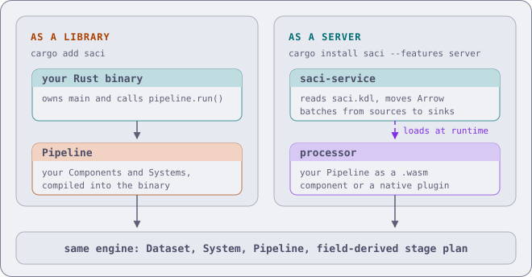
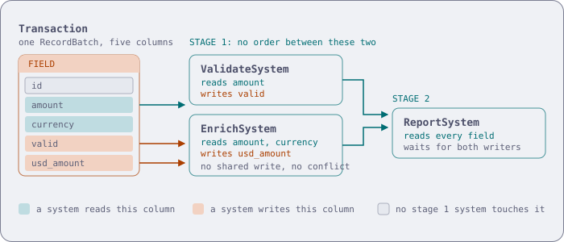
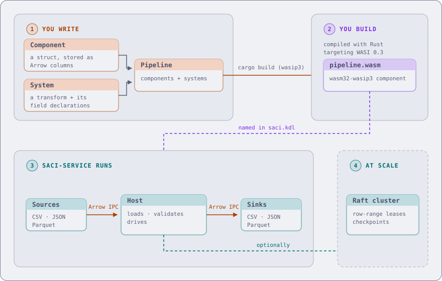

<div align="center">
  

  <h1>SACI</h1>

  <p><strong>Data pipelines that schedule themselves, from the fields each transform declares.</strong></p>

[](https://crates.io/crates/saci)
[](https://nassor.github.io/saci/)
[](https://github.com/nassor/saci/actions/workflows/ci.yml)
[](LICENSE)
[](https://www.rust-lang.org)
[](#project-status)

</div>

SACI is a columnar batch processing engine for Rust, built on Apache Arrow. Each transform declares
the Arrow fields it reads and writes, and SACI derives the execution order from those declarations:
transforms that write different fields share a stage, the rest wait for their inputs, and a
transform that declares a retry mode is retried when it fails with a transient error.

The `saci` crate is used in two ways:

- As a library: `cargo add saci` puts the engine in your own binary. You own `main`, build a
  `Pipeline` and call `pipeline.run()`.
- As a server: `cargo install saci --features server` installs `saci-service`. It reads a KDL
  config, moves Arrow batches from sources to sinks, and runs your pipeline as a WebAssembly
  component or a native plugin that it loads at runtime.



Each part of the crate sits behind a Cargo feature. The default build is the engine alone; the
server, its WebAssembly host and each connector compile only when you name them.

## How SACI plans the work



A `Component` is a struct stored as Arrow columns. A `System` is a transform plus a `meta()` that
names the fields it reads and writes. The `Pipeline` builds a dependency graph from those field
overlaps and groups systems that cannot conflict into stages; you never write a stage list, and
adding a system re-derives the plan. That is the "self-orchestrated" in SACI's name,
Self-orchestrated Autonomous Compute Interface. The Component and System vocabulary comes from the
Entity Component System pattern in game engines.

## As a library

You need git and a Rust 1.100 toolchain installed through rustup. These commands run the same on
Linux, macOS and Windows (PowerShell):

```bash
git clone https://github.com/nassor/saci
cd saci
cargo run -p saci --example scheduler_etl
```

It prints the stage plan SACI derived (ValidateSystem and EnrichSystem share stage 1 because they
write disjoint fields), then a summary: `Pipeline complete: 7/9 valid, 2 rejected`.

In your own project, `cargo add saci` and follow the example in the
[`saci` crate README](./crates/saci/README.md). The same `Pipeline` also takes sources and sinks
from the connector features, `Scheduler` runs several pipelines in dependency order, and the
`distributed` feature spreads one across nodes. The
[library tutorial](https://nassor.github.io/saci/library/first-pipeline/) builds a pipeline step by
step.

## As a server



The processor owns the stage plan and retry. The host owns IO, checkpointing, distribution, the
HTTP control plane and a `/ui` dashboard. Data crosses between them as Arrow IPC bytes and nothing
else, so a processor never opens a socket or a file, and it can be rebuilt without rebuilding the
host.

From the clone, this builds the order-processing component and `saci-service`, then runs one
config end to end: a CSV file source, the component, a CSV file sink. You also need the WebAssembly
target, `rustup target add wasm32-wasip3`. The command runs the same on Linux, macOS and Windows
(PowerShell):

```bash
cargo xtask demo standalone_wasm
```

The log ends with `rows_processed=5 iteration_errors=0` and `[demo] PASS: 'standalone_wasm' ran to
completion`.

To install the binary on its own, `cargo install saci --features server`; `saci-service --version`
confirms it. [Your first pipeline](https://nassor.github.io/saci/service/first-pipeline/) writes a
config and a processor from scratch.

### WASI 0.3 processors and native plugins

The pipeline contract is the `saci:pipeline@0.4.0` WIT world (`run-batch: async func(...)`).
Rust processors compile directly to pure WASI 0.3 (`wasm32-wasip3`) components with
`cargo build --target wasm32-wasip3`:

```bash
rustup target add wasm32-wasip3
cargo install wasm-tools --locked --version 1.246.2
cargo xtask quickstart
```

`examples/quickstart/` chains two Rust WASI 0.3 stages (`validate.wasm` and `settle.wasm`) between
NATS and PostgreSQL, and `examples/wasm/settle/` demonstrates stateful settlement over the same
12-column `Order` schema.

A processor written in another language or requiring native threads runs as a
[native plugin](https://nassor.github.io/saci/service/plugins/) instead: a shared library the
service loads through the C ABI in `crates/saci/include/saci_plugin.h` (see
`examples/plugins/settle-go/`).

[Build a processor](https://nassor.github.io/saci/service/processors/build/) has the byte-level
contract and the Rust recipe.

## When SACI fits

Reach for SACI when:

- Work arrives as batches of 100k to 100M rows, or as a stream of items processed one at a time.
  [Stream mode](https://nassor.github.io/saci/service/config/run-modes/) runs the same pipeline
  under a millisecond per item in-process; batch mode is the default.
- The transform is imperative code that SQL expresses awkwardly.
- Schemas are wide, tens to hundreds of columns, and each step touches a few.
- Recovery time is a design constraint.

Look elsewhere when you want SQL ([DataFusion](https://datafusion.apache.org/) has a query
planner; SACI has none), when you need exactly-once delivery (recovery is at-least-once, so a sink
must tolerate a repeated batch), or when you have fewer than about 10k rows and a `Vec` would do.

## Why columns

Storing each field as a contiguous Arrow column, rather than a row per record, changes what the
machine moves:

- A system reading 3 of 50 eight-byte columns loads 24 MB per million rows, where a row layout
  loads 400 MB.
- Handing a batch to the next stage is an `Arc` clone: one atomic increment, no copy.
- A checkpoint is a contiguous buffer write, so recovery decodes 6x faster than a row-oriented
  equivalent at 1M rows.

Numbers and method: [benchmark results](https://nassor.github.io/saci/library/reference/benchmarks/).

## Documentation

| Running the server | |
|---|---|
| [Run the service](https://nassor.github.io/saci/service/) | What a config declares, and the vocabulary behind every key |
| [Your first pipeline](https://nassor.github.io/saci/service/first-pipeline/) | Install the binary, then run a real pipeline in 15 minutes |
| [The config file](https://nassor.github.io/saci/service/config/) | Every top-level key, variables, and validation |
| [Encryption and TLS](https://nassor.github.io/saci/service/config/encryption/) | Transport TLS/mTLS, encrypted codecs, and field/payload AEAD |
| [Sources and sinks](https://nassor.github.io/saci/service/connectors/) | One page per connector, as a source and as a sink |
| [Formats](https://nassor.github.io/saci/service/formats/) | csv, ndjson, parquet, avro and arrow-ipc |
| [Build a processor](https://nassor.github.io/saci/service/processors/build/) | The WIT contract, a recipe per language, and the six-language example |
| [Plugins](https://nassor.github.io/saci/service/plugins/) | A native shared library instead of a component |
| [Operating](https://nassor.github.io/saci/service/operate/) | The command line, observability, the dashboard, clusters |

| Using the library | |
|---|---|
| [Embedding SACI](https://nassor.github.io/saci/library/) | Dataset, System, Pipeline, Scheduler, distribution |
| [Build your first pipeline](https://nassor.github.io/saci/library/first-pipeline/) | A native pipeline in nine steps, from the component to the stage plan |
| [Tracing & metrics](https://nassor.github.io/saci/library/tracing/) | Spans, metrics, and the Prometheus endpoint |
| [Crates and features](https://nassor.github.io/saci/library/reference/crates/) | Every feature flag and the module behind it |

The repository also holds the [WASM processor examples](./examples/wasm/), the
[branching](./examples/branching/), [windowing](./examples/windowing/) and
[cluster](./examples/distributed_fulfillment/) examples, Rust examples in
[`crates/saci/examples`](./crates/saci/examples/) and [`examples/native`](./examples/native/), the
Apache-2.0 [Arrow IPC conformance corpus](./packages/arrow-ipc-conformance/), and toolchain pins
for [Rust processors](./crates/saci/PINS.md).

## Crates

Two crates are on crates.io:

- [`saci`](./crates/saci/): the engine, the connectors, the byte formats, both authoring SDKs and
  the `saci-service` host.
- [`saci-macros`](./crates/saci-macros/): the derive and attribute macros of both authoring SDKs,
  which `saci` re-exports at its root and in `saci::prelude`.

| Feature | What it adds |
|---|---|
| `engine` (default) | `Dataset`, `Component`, `System`, `Pipeline`, `Scheduler`, the `Source`/`Sink` traits, tokio and rayon stage parallelism |
| `derive` | `#[derive(Component)]`; included in `engine`, `processor` and `plugin` |
| `connector-<name>`, `codec-<format>` | One transport or one byte format each, in `saci::connector` and `saci::codec` |
| `processor` | The processor SDK and the canonical `saci:pipeline@0.4.0` WIT world |
| `plugin` | The native plugin SDK and its C ABI |
| `tls`, `crypto` | Shared `rustls` TLS/mTLS helpers and AES-256-GCM / ChaCha20-Poly1305 codec, field, and batch encryption (`crypto` is in `server`) |
| `server` | The `saci-service` binary: wasmtime, KDL config, HTTP control plane, distributed runner |

`cargo xtask server` builds a `saci-service` from a checkout with only the connectors, formats and
processor hosts you name. Release notes are in [`CHANGELOG.md`](./CHANGELOG.md). The workspace map
and the build, test and release commands are in [`AGENTS.md`](./AGENTS.md), with per-area
reference under `.agents/skills/`.

## Project status

This is a playground project exploring two things:

1. How far specialised AI coding agents can maintain a non-trivial Rust codebase, spanning
   multiple crates, a binary, and a WebAssembly component, with minimal human intervention in
   maintenance and review.
2. The design space of a Rust-native batch engine with WebAssembly extensibility.

Contributions and feedback are welcome.

## License

Licensed under the GNU Affero General Public License v3.0. See [LICENSE](LICENSE). The `packages/`
subtree is Apache-2.0, see [packages/LICENSE-APACHE](packages/LICENSE-APACHE).
