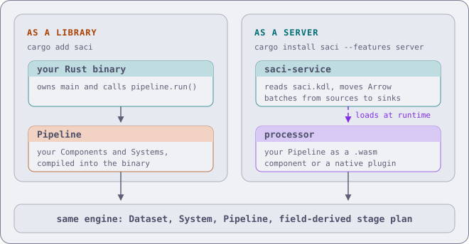

# saci

[](https://crates.io/crates/saci)
[](https://docs.rs/saci)
[](https://github.com/nassor/saci/blob/main/LICENSE)

A columnar batch processing engine for Rust, built on Apache Arrow. Each transform declares the
Arrow fields it reads and writes; SACI derives the execution order from those declarations, runs
transforms that write different fields in the same stage, and retries a transient failure when a
transform asks for it.

The crate is used in two ways:

- As a library: your binary depends on `saci`, owns `main` and runs a `Pipeline` in process.
- As a server: `cargo install saci --features server` builds `saci-service`, which reads a KDL
  config and runs your pipeline as a WebAssembly component or a native plugin.



Each part sits behind a feature, so a build compiles only what it names. The default, `engine`, is
the engine alone.

## As a library

```toml
[dependencies]
saci = "0.1"
serde = { version = "1", features = ["derive"] }
tokio = { version = "1", features = ["macros", "rt-multi-thread"] }
```

Rust 1.100 or newer. One component and one system: `ToUsd` reads `amount` and writes `usd_amount`,
and that declaration is the only scheduling input the pipeline needs.

```rust
use std::sync::Arc;

use saci::arrow_array::Float64Array;
use saci::prelude::*;
use serde::{Deserialize, Serialize};

#[derive(Component, Serialize, Deserialize)]
struct Order {
    amount: f64,
    usd_amount: f64,
}

struct ToUsd;

#[async_trait]
impl ParallelSystem for ToUsd {
    fn meta(&self) -> SystemMeta {
        SystemMeta::new("to_usd")
            .reads(Order::AMOUNT)
            .writes(Order::USD_AMOUNT)
    }

    async fn run(&self, data: &Dataset) -> SaciResult<WriteSet> {
        let orders = data.view::<Order>()?;
        let amount = orders.f64(Order::AMOUNT)?;
        let usd: Vec<f64> = (0..orders.len()).map(|i| amount.value(i) * 1.08).collect();
        Ok(WriteSet::new().put(Order::USD_AMOUNT, Arc::new(Float64Array::from(usd))))
    }
}

#[tokio::main]
async fn main() -> SaciResult<()> {
    let mut pipeline = Pipeline::new("orders")
        .component::<Order>()
        .parallel_system(ToUsd);
    pipeline.data_mut().append(&[
        Order { amount: 120.0, usd_amount: 0.0 },
        Order { amount: 12.0, usd_amount: 0.0 },
    ])?;
    pipeline.run().await?;

    let usd = pipeline.data().column(Order::USD_AMOUNT)?;
    println!("{usd:?}");
    Ok(())
}
```

The package carries nine runnable examples in `examples/`. From a clone of the repository:

```bash
cargo run -p saci --example first_pipeline
```

## As a server

```bash
cargo install saci --features server
saci-service --version
```

`saci-service` reads a KDL config that names sources, a processor and sinks, moves Arrow batches
through them, and serves an HTTP control plane with a `/ui` dashboard. The processor is your
pipeline built for wasm32-wasip3 against the `processor` feature, which leaves tokio out:

```toml
[dependencies]
saci = { version = "0.1", default-features = false, features = ["processor"] }
```

[Your first pipeline](https://nassor.github.io/saci/service/first-pipeline/) writes a config and a
processor and runs them end to end.

## Features

| Feature | What it adds |
|---|---|
| `engine` (default) | `Dataset`, `Component`, `System`, `Pipeline`, `Scheduler`, the `Source` and `Sink` traits |
| `derive` | `#[derive(Component)]`; included in `engine`, `processor` and `plugin` |
| `windows` | Tumbling, sliding and session windows with watermarks |
| `connector-<name>` | One transport in `saci::connector`; `connectors` enables the seven that need no external service |
| `transformer-<format>` | One byte format in `saci::transformer`; `transformers` enables all five |
| `processor` | The wasm32-wasip3 processor SDK and the `saci:pipeline@0.4.0` WIT world |
| `plugin` | The native plugin SDK and its C ABI |
| `service`, `wasm-host`, `plugin-host` | The host: KDL config, runners, HTTP control plane, the two processor hosts |
| `server` | The `saci-service` binary with the self-contained connectors and every format |

[Crates and features](https://nassor.github.io/saci/library/reference/crates/) lists every feature.

## Links

- [Documentation site](https://nassor.github.io/saci/)
- [API reference](https://docs.rs/saci)
- [Repository](https://github.com/nassor/saci)
- [Changelog](https://github.com/nassor/saci/blob/main/CHANGELOG.md)

## License

GNU Affero General Public License v3.0 only.
