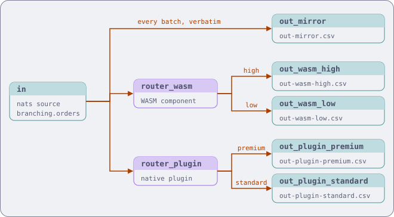

# Branching: one source, three fan-out splits

One `saci-service` stream reads a NATS subject and fans every message out three ways, each into its own CSV files:

- Source split: the source's three links carry no `branch`, so every batch goes to the mirror sink and to both routers.
- WASM split: `router_wasm` names `high` or `low` per batch, and the host delivers the batch only to the link with that `branch`.
- Plugin split: `router_plugin` does the same with `premium` or `standard`.



Both routers read the first row's `priority` and insert a `RouteDecision`. The publisher draws `high` and `low` 50/50, so every branch fills while it runs. The concept and the load-time rules are on the [Branching page](../../docs/content/service/processors/branching.md); this file is the commands.

## Prerequisites

- A clone of the repository. Every command runs from its root.
- Rust with the `wasm32-wasip2` target: `rustup target add wasm32-wasip2`
- A Docker daemon, for NATS.

## 1. Build the processors

Runs the same on Linux, macOS and Windows (PowerShell):

```text
cargo build --release -p branching-wasm --target wasm32-wasip2
cargo build --release -p branching-plugin
```

This writes `target/wasm32-wasip2/release/branching_wasm.wasm` and the plugin library. The config's default plugin path is the Linux name, so macOS and Windows point `SACI_PLUGIN_LIB` at theirs in step 3:

| Platform | Plugin artifact |
|----------|-----------------|
| Linux | `target/release/libbranching_plugin.so` (the config default) |
| macOS | `target/release/libbranching_plugin.dylib` |
| Windows | `target/release/branching_plugin.dll` |

## 2. Start NATS

Runs the same on all three platforms:

```text
docker run -d --name saci-nats -p 4222:4222 nats:2.11-alpine
```

## 3. Start the service

`SACI_OUT_DIR` is where the five CSV files land. The directory must exist before `serve` starts. The service runs until Ctrl-C.

Linux:

```bash
mkdir -p /tmp/saci-branching
SACI_OUT_DIR=/tmp/saci-branching \
cargo run -p saci --features server,plugin-host,connector-nats -- serve \
  --config examples/branching/branching.kdl
```

macOS:

```bash
mkdir -p /tmp/saci-branching
SACI_OUT_DIR=/tmp/saci-branching \
SACI_PLUGIN_LIB=target/release/libbranching_plugin.dylib \
cargo run -p saci --features server,plugin-host,connector-nats -- serve \
  --config examples/branching/branching.kdl
```

Windows (PowerShell):

```powershell
mkdir C:\saci-branching
$env:SACI_OUT_DIR = "C:/saci-branching"
$env:SACI_PLUGIN_LIB = "target/release/branching_plugin.dll"
cargo run -p saci --features server,plugin-host,connector-nats -- serve --config examples/branching/branching.kdl
```

To check the link graph first, run the same command with `validate` in place of `serve` and `--strict` at the end. Validation opens no NATS connection.

## 4. Publish orders

In a second terminal, from the repository root. Runs the same on all three platforms:

```text
cargo run -p saci --features connector-nats --example branching_publish -- --rate 50
```

The publisher sends one NDJSON object per message to `branching.orders` and runs until Ctrl-C. Its flags:

| Flag | Default | Meaning |
|------|---------|---------|
| `--count N` | `0` | messages to send; 0 runs until Ctrl-C |
| `--rate N` | `50` | messages per second |
| `--url URL` | `nats://localhost:4222` | NATS server |
| `--subject NAME` | `branching.orders` | subject to publish on |
| `--seed N` | a fixed constant | a re-run reproduces the same priority sequence |

## 5. Check the files

Each file starts with the header `id,priority`.

| File | Rows |
|------|------|
| `out-mirror.csv` | every message, in arrival order |
| `out-wasm-high.csv` | `high` rows |
| `out-wasm-low.csv` | `low` rows |
| `out-plugin-premium.csv` | `high` rows |
| `out-plugin-standard.csv` | `low` rows |

A router decides from the first row of each pass, and a pass holds one message while the publisher is slow enough for the source's 5 ms poll window to close between messages. Look at the start of two files:

Linux/macOS:

```bash
head -n 4 /tmp/saci-branching/out-mirror.csv /tmp/saci-branching/out-wasm-high.csv
```

Windows (PowerShell):

```powershell
Get-Content C:/saci-branching/out-mirror.csv -TotalCount 4
Get-Content C:/saci-branching/out-wasm-high.csv -TotalCount 4
```

The mirror file mixes both priorities, and `out-wasm-high.csv` holds only `high`.

Stop the publisher and the service with Ctrl-C, then remove NATS (same on all platforms):

```text
docker rm -f saci-nats
```

## One command for the build

`cargo xtask demo branching` builds both processors and `saci-service`, writes `target/xtask/branching.kdl` with the plugin path and output directories already filled in, and prints the `serve` and publisher commands. It needs no environment variables on any platform. Its files land in `saci-xtask-branching` under the system temp directory.

## Files

| Path | What it is |
|------|------------|
| `branching.kdl` | the stream workflow with all three splits |
| `branching_publish.rs` | the `branching_publish` example that feeds the subject |
| `wasm/` | `branching-wasm`, the WASM router (cdylib, `wasm32-wasip2`) |
| `plugin/` | `branching-plugin`, the native router (cdylib) |
