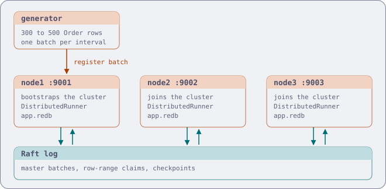

# Distributed Order Fulfillment

A 3-node SACI Raft cluster that processes synthetic orders through a four-stage pipeline. It exercises field-granular DAG scheduling, parallel and sequential systems, world resources, checkpointing, Raft consensus and structured tracing.



The Raft log carries the work pool itself: master batches, row-range claims and checkpoints are applied from the log into each node's own `app.redb`, so the cluster needs no external store.

Node 1 bootstraps the cluster and runs the order generator. Every `--generator-interval` seconds (default 2) it creates 300 to 500 synthetic `Order` rows and registers them as a master batch. All three nodes run a `DistributedRunner` that claims, processes, checkpoints and acks batches. A claim is a Raft-committed state transition, so one node processes each row range, and the claim and ack cycle gives at-least-once delivery.

## The pipeline

Each batch runs four stages over `Order` rows:

| Stage | Systems | Access |
|-------|---------|--------|
| 0 | `ValidateOrderSystem`, `DetectFraudSystem`, `ConvertCurrencySystem` | parallel (`ParallelSystem`), disjoint field writes |
| 1 | `CheckInventorySystem` | sequential (`System`, exclusive world access) |
| 2 | `ApproveOrderSystem`, `ComputeTaxSystem` | parallel, disjoint field writes |
| 3 | `GenerateInvoiceSystem` | sequential, appends `Invoice` rows |

The field-level conflict analyser groups the parallel stages. A checkpoint is saved every two stages (`CheckpointStrategy::EveryNStages(2)`), and `GenerateInvoiceSystem` retries up to 3 times with a fixed 50 ms delay. `Invoice` rows stay in the in-memory dataset: the example accepts `--output-dir` but writes nothing to it.

## Prerequisites

- Rust 1.99 or newer, for the local path
- A running Docker daemon, for the Compose path

Run every command from the repository root. They are identical on Linux, macOS and Windows (PowerShell) unless a step says otherwise.

## Run with Docker Compose

1. Build the image and start the three nodes:

   ```text
   docker compose -f examples/distributed_fulfillment/docker-compose.yml up --build
   ```

2. In a second terminal, follow the logs:

   ```text
   docker compose -f examples/distributed_fulfillment/docker-compose.yml logs -f --tail=50 node1 node2 node3
   ```

   The nodes log JSON. Within a few seconds a line with the message `cluster has leader` appears, then `generator: registered batch` lines from node 1 with `node_id`, `batch_id` and `rows` fields, then per-stage lines such as `stage 2: tax computation complete` from whichever node claimed the batch.

3. Stop the cluster:

   ```text
   docker compose -f examples/distributed_fulfillment/docker-compose.yml down
   ```

   The nodes keep their Raft state in the named volume `data`. Add `-v` to delete it and start the next run from an empty cluster.

## Run locally

Build the example once:

```text
cargo build -p saci --example distributed_fulfillment --features service-cluster
```

Then start three nodes, one per terminal, node 1 first. `--peers` lists the other two nodes in node-id order. Set `RUST_LOG=trace` to see every system's log line.

Node 1 bootstraps the cluster and runs the generator.

Linux/macOS:

```text
RUST_LOG=trace ./target/debug/examples/distributed_fulfillment \
  --node-id 1 --bootstrap \
  --listen 127.0.0.1:9001 \
  --data-dir /tmp/fulfillment/node1 \
  --output-dir /tmp/fulfillment/output/node1 \
  --peers 127.0.0.1:9002,127.0.0.1:9003 \
  --generator-interval 10
```

Windows (PowerShell):

```powershell
$env:RUST_LOG = "trace"
.\target\debug\examples\distributed_fulfillment.exe --node-id 1 --bootstrap --listen 127.0.0.1:9001 --data-dir C:\fulfillment\node1 --output-dir C:\fulfillment\output\node1 --peers 127.0.0.1:9002,127.0.0.1:9003 --generator-interval 10
```

Node 2, Linux/macOS:

```text
RUST_LOG=trace ./target/debug/examples/distributed_fulfillment \
  --node-id 2 \
  --listen 127.0.0.1:9002 \
  --data-dir /tmp/fulfillment/node2 \
  --output-dir /tmp/fulfillment/output/node2 \
  --peers 127.0.0.1:9001,127.0.0.1:9003
```

Node 2, Windows (PowerShell):

```powershell
$env:RUST_LOG = "trace"
.\target\debug\examples\distributed_fulfillment.exe --node-id 2 --listen 127.0.0.1:9002 --data-dir C:\fulfillment\node2 --output-dir C:\fulfillment\output\node2 --peers 127.0.0.1:9001,127.0.0.1:9003
```

Node 3, Linux/macOS:

```text
RUST_LOG=trace ./target/debug/examples/distributed_fulfillment \
  --node-id 3 \
  --listen 127.0.0.1:9003 \
  --data-dir /tmp/fulfillment/node3 \
  --output-dir /tmp/fulfillment/output/node3 \
  --peers 127.0.0.1:9001,127.0.0.1:9002
```

Node 3, Windows (PowerShell):

```powershell
$env:RUST_LOG = "trace"
.\target\debug\examples\distributed_fulfillment.exe --node-id 3 --listen 127.0.0.1:9003 --data-dir C:\fulfillment\node3 --output-dir C:\fulfillment\output\node3 --peers 127.0.0.1:9001,127.0.0.1:9002
```

Each node logs `cluster has leader` once a leader is elected and has committed its first entry, or fails after 30 seconds. Stop a node with Ctrl-C.

## What the logs show

`--log-json` switches the logs to JSON. The lines come from the example's `tracing` calls:

| Log message | Meaning |
|-------------|---------|
| `cluster has leader` | Raft elected a leader and committed |
| `generator: registered batch` | the generator registered a master batch |
| `generator: skipping batch (not leader or cluster error)` | registering failed, for example during an election, so the round was skipped |
| `stage N: ... complete` | a system finished on the claiming node; fields include `node_id`, `stage`, `system` and `rows` |

## Files

| File / directory | What it is |
|------------------|------------|
| `main.rs` | the CLI, the Raft node and the `DistributedRunner` loop |
| `systems.rs` | the four-stage pipeline and its seven systems |
| `resources.rs` | the non-columnar resources: `FxRateTable`, `TaxRateTable`, `InventoryCatalog`, `NodeId` |
| `components.rs` | the `Order` and `Invoice` components |
| `store.rs` | `FulfillmentStore`, the wrapper that loads each claimed batch into a dataset |
| `generator.rs` | the synthetic `Order` batch generator |
| `docker-compose.yml` | the three nodes and their shared `data` volume |
| `Dockerfile` | the release build Compose uses |
| `config/` | per-node YAML listing the same settings as the flags; the example does not read them |
