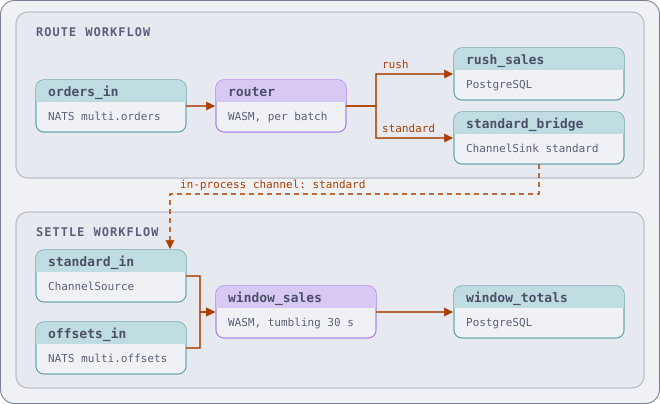

# Multi-workflow: one stream routed across two workflows

A service can declare several workflows in one config. Each has its own nodes, links, sources and sinks, and all of them run concurrently in one process. A `link` never leaves its workflow, so the only crossing is an in-process channel: a `ChannelSink` in one workflow and a `ChannelSource` in another that share a channel `name`. The workflow and channel keys are on the [workflows config page](../../docs/content/service/config/workflows.md) and the [channel connector page](../../docs/content/service/connectors/channel.md). This file is the commands.



`multi_workflow.kdl` is a long-running `saci-service` stream:

- `route` reads `multi.orders` and the `router` processor sends each batch to one branch, by the first row's `amount`. `rush` (`amount >= 100.0`) goes to the `rush_sales` table untouched. `standard` goes to the `standard` channel.
- `settle` merges that channel and a second subject, `multi.offsets`, into 30 second tumbling windows and writes the closed windows to `window_totals`.

Both workflows use the same `Sale` schema (`timestamp_ms`, `symbol`, `amount`), so rows cross the channel unchanged.

## Prerequisites

- A clone of the repository. Every command runs from its root.
- Rust with the `wasm32-wasip2` target: `rustup target add wasm32-wasip2`
- A Docker daemon, for NATS and PostgreSQL.

## 1. Build the processors

The router is this example's own crate. The windowed half reuses the tumbling windowing example's component. Runs the same on Linux, macOS and Windows (PowerShell):

```text
cargo build --release -p multi-workflow-router-wasm --target wasm32-wasip2
cargo build --release -p windowing-tumbling-wasm --target wasm32-wasip2
```

## 2. Start the containers

Runs the same on all three platforms:

```text
docker compose -f examples/multi_workflow/docker-compose.yml up -d
```

This starts `nats:2.11-alpine` and `postgres:18-alpine`. PostgreSQL runs `schema.sql` only when its data directory is empty, and the sinks never create tables. If a sink fails with `table ... does not exist`, recreate the volume:

```text
docker compose -f examples/multi_workflow/docker-compose.yml down -v
docker compose -f examples/multi_workflow/docker-compose.yml up -d
```

Or apply the SQL to the running database.

Linux/macOS:

```bash
docker compose -f examples/multi_workflow/docker-compose.yml exec -T postgres psql -U postgres -d saci < examples/multi_workflow/schema.sql
```

Windows (PowerShell):

```powershell
Get-Content examples/multi_workflow/schema.sql | docker compose -f examples/multi_workflow/docker-compose.yml exec -T postgres psql -U postgres -d saci
```

## 3. Start the service

Runs the same on all three platforms. It stays up until Ctrl-C.

```text
cargo run -p saci --features server,connector-nats,connector-postgresql -- serve --config examples/multi_workflow/multi_workflow.kdl
```

To check the config without running it, use `validate` in place of `serve` and add `--strict`.

## 4. Publish sales

In a second terminal. Runs the same on all three platforms:

```text
cargo run -p saci --features connector-nats --example multi_workflow_publish -- --rate 20 --ts-step-ms 2000
```

The publisher alternates NDJSON messages between `multi.orders` and `multi.offsets`. Each carries `timestamp_ms` (simulated event time), `symbol` (`AAPL`, `GOOG` or `MSFT`) and `amount` (50.0 to 150.0, so the 100.0 threshold splits the stream about in half). At these settings the simulated clock runs 40 seconds per wall second.

## 5. Check the tables

After a few seconds:

```text
docker compose -f examples/multi_workflow/docker-compose.yml exec -T postgres psql -U postgres -d saci -c 'SELECT count(*) FROM public.rush_sales; SELECT count(*) FROM public.rush_sales WHERE amount < 100.0; SELECT * FROM public.window_totals ORDER BY window_id, symbol;'
```

The first count grows and `window_totals` fills continuously. The router decides from the first row of each pass, so the second count is `0` while every pass carries one message.

| Table | Holds |
|-------|-------|
| `public.rush_sales` | every `rush` row, untouched; upserts on `(timestamp_ms, symbol)` |
| `public.window_totals` | one row per closed window and symbol: `window_id`, `symbol`, `count`, `sum`; upserts on `(window_id, symbol)` |

A window starts at `window_id * 30000` ms. The last window before the publisher stops stays open, because a window closes only when the watermark passes its end and the watermark moves with the data.

## 6. Open the dashboard

Open http://127.0.0.1:8080/ui. The Pipelines tab draws one card per workflow, `route` and `settle`, each with its own run and error badges. A `channel bridges` card below them lists `standard` with its live rate. The `window_sales` box carries a `⟐30s` window chip, and its detail sheet shows the window geometry, the time and key fields, the lateness budget and the live watermark.

## Restart the service with the publisher

The simulated clock starts at the same base on every run. A publisher restarted against a running service rewinds event time, but the `window_sales` watermark does not rewind. Every arrival is then past the 5 second lateness budget, the node drops all of it, and `window_totals` stops filling while the other nodes keep reporting work. The service logs one warning on the `saci::windowing` target, counts each drop in `saci_window_late_arrivals_total`, and shows a `dropped arrivals` row on the `window_sales` sheet. Stop and start both together.

Stop the containers and delete their data with:

```text
docker compose -f examples/multi_workflow/docker-compose.yml down -v
```

## Publisher flags

| Flag | Default | Meaning |
|------|---------|---------|
| `--count N` | `0` | messages to send; 0 runs until Ctrl-C |
| `--rate N` | `20` | messages per second |
| `--ts-step-ms N` | `2000` | simulated milliseconds per message |
| `--url URL` | `nats://localhost:4222` | NATS server |
| `--subject-a NAME`<br>`--subject-b NAME` | `multi.orders`<br>`multi.offsets` | the two subjects |
| `--seed N` | a fixed constant | a re-run reproduces the same sequence |

## Files

| Path | What it is |
|------|------------|
| `multi_workflow.kdl` | the `route` and `settle` workflows, bridged by the `standard` channel |
| `multi_workflow_publish.rs` | the `multi_workflow_publish` example that feeds both subjects |
| `schema.sql` | the `rush_sales` and `window_totals` tables |
| `docker-compose.yml` | NATS 2.11 and PostgreSQL 18 |
| `wasm/` | `multi-workflow-router-wasm`, the router (cdylib, `wasm32-wasip2`) |
