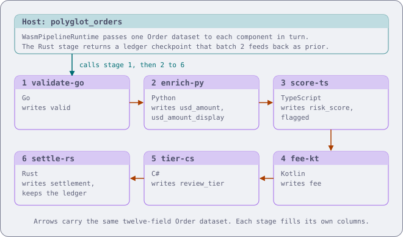

# Polyglot: one pipeline, six languages

One workload implemented as six WebAssembly components, written in Go, Python,
TypeScript, Kotlin, C# and Rust. All six export the same `saci:pipeline@0.3.0`
WIT world and operate on the same twelve-field `Order` component. Each stage
reads the fields an earlier one wrote and writes its own. Any language that
compiles to a WASI 0.2 component can be a SACI stage.



| # | stage | language | reads | writes |
|---|-------|----------|-------|--------|
| 1 | `polyglot-validate-go` | Go | `amount` | `valid` |
| 2 | `polyglot-enrich-py` | Python | `valid`, `currency`, `amount` | `usd_amount`, `usd_amount_display` |
| 3 | `polyglot-score-ts` | TypeScript | `usd_amount` | `risk_score`, `flagged` |
| 4 | `polyglot-fee-kt` | Kotlin | `valid`, `region`, `usd_amount` | `fee` |
| 5 | `polyglot-tier-cs` | C# | `flagged`, `risk_score` | `review_tier` |
| 6 | `polyglot-settle-rs` | Rust | `valid`, `review_tier`, `usd_amount`, `fee` | `settlement`, `Ledger` |

## Prerequisites

Versions are pinned in [`PINS.md`](PINS.md), which also lists the platform
caveats. Notably, `go install` of `componentize-go` yields a broken wrapper on
Windows, and `PINS.md` has the workaround. `cargo xtask polyglot` checks every
tool the requested stages need before it builds anything.

- Rust 1.99.0 with the `wasm32-wasip2` target: `rustup target add wasm32-wasip2`
- `wasm-tools` 1.246.2
- Go 1.25.5+ with `componentize-go` 0.4.1
- Python 3.10+ with `componentize-py` 0.25.0
- Node 24.12+ with `@bytecodealliance/jco` 1.30.0 and `typescript` 5.9.3
- JDK 21, Gradle 8.14.4+, and the Kotlin `wit-bindgen` fork (branch `kotlin`,
  reports 0.57.1); Gradle fetches Kotlin 2.4.0
- .NET SDK 10 (verified on 10.0.400); the first C# build downloads wasi-sdk
  29.0, about 535 MB, into `~/.wasi-sdk/`

The five non-Rust stages each use one `saci-sdk-*` package from `packages/`,
which carries its language's Arrow IPC codec.

## Build and run

Run every command from the repository root. They are the same on Linux, macOS
and Windows (PowerShell).

1. Build all six components into `examples/polyglot/build/` and run
   `wasm-tools validate` on each:

   ```text
   cargo xtask polyglot
   ```

   `ls examples/polyglot/build` lists `validate-go.wasm`, `enrich-py.wasm`,
   `score-ts.wasm`, `fee-kt.wasm`, `tier-cs.wasm` and `settle-rs.wasm`.

   With one toolchain, build a subset with `--only`, a comma-separated list of
   `rust`, `go`, `python`, `ts`, `kotlin` and `csharp`:

   ```text
   cargo xtask polyglot --only=rust
   cargo xtask polyglot --only=go,ts
   ```

   A missing tool exits with its own code: 3 wasm-tools, 4 Go, 5
   componentize-go, 6 componentize-py, 7 Node or npm, 9 Gradle, 10 wit-bindgen,
   11 dotnet, 12 curl. Code 8 means a stage built without producing an artifact.

2. Drive the chain. `tracing` makes the processors' log and metric calls
   visible:

   ```text
   cargo run -p saci --features wasm-host,tracing --example polyglot_orders
   ```

   The output has a `describe()` block with one line per stage, then two
   batches over the six-row fixture. It ends with
   `ledger after batch 2: settled_count = 4, settled_usd = 13708.56` and an
   `OK: six languages, one WIT world.` line. Any fingerprint or component
   mismatch between the stages exits non-zero instead.

   Batch 1 produces this table. Every value except `settlement` comes from a
   component containing no Rust:

   | id | region | currency | amount | valid | usd_amount | usd_amount_display | risk_score | flagged | fee | review_tier | settlement |
   |----|--------|----------|--------|-------|------------|--------------------|------------|---------|-----|-------------|------------|
   | 1 | emea | EUR | 100 | true | ≈110.0 | 110.00 USD | ≈0.0022 | false | ≈1.32 | 0 | SETTLED |
   | 2 | emea | GBP | -5 | false | 0.0 |  | 0.0 | false | 0.0 | 0 | REJECTED |
   | 3 | apac | JPY | 1000000 | true | ≈6800.0 | 6800.00 USD | ≈0.136 | false | ≈54.4 | 0 | SETTLED |
   | 4 | amer | USD | 60000 | true | 60000.0 | 60000.00 USD | 1.2 | true | 600.0 | 2 | HOLD |
   | 5 | emea | EUR | 0 | false | 0.0 |  | 0.0 | false | 0.0 | 0 | REJECTED |
   | 6 | apac | USD | 20000 | true | 20000.0 | 20000.00 USD | 0.4 | false | 160.0 | 1 | REVIEW |

   The Rust stage keeps a ledger of settled rows. After batch 1 it reads
   `settled_count = 2, settled_usd = 6854.28`. The host passes that checkpoint
   back for batch 2, and the driver checks that both totals doubled.

3. Run the same assertions as a regression test. It prints `SKIP:` and passes
   when `build/` is absent:

   ```text
   cargo test -p saci --features server,wasm-host --test polyglot_chain -- --nocapture
   ```

`SACI_POLYGLOT_BUILD_DIR` points the driver and the test at another directory
of components.

## Code generation

The `polyglot_schema_emit` example writes schema constants into the gitignored
`examples/polyglot/generated/`, which also caches the WASI preview 1 adapter
that the Kotlin build needs. No polyglot stage uses the constants; the Quick
Start and the native plugin builds do. Regenerate them with:

```text
cargo run -p saci --features wasm-host --example polyglot_schema_emit -- emit
```

| file | consumed by |
|------|-------------|
| `order_schema.ipc` | reference copy of the schema-only IPC stream |
| `order_fingerprint.txt` | `cargo xtask quickstart` and `cargo xtask plugins`, which log the fingerprint of the 12-field `Order` (`f6405a7b`) |
| `fixture_input.saci`<br>`fixture_input.json` | the SDK codec tests under `packages/` |
| `schema_gen.go` | copied to `examples/plugins/settle-go/schema_gen.go` by `cargo xtask plugins` |
| `SchemaGen.cs` | copied to `examples/quickstart/stages/csharp-settle/SchemaGen.cs` by `cargo xtask quickstart` |
| `schema_gen.py`<br>`schema_gen.ts`<br>`SchemaGen.kt` | emitted for reference; no build uses them |

Each stage declares its own `Order` in its own language. The driver and the
test load all six components and require equal `schema_fingerprint` values, so
six independently written schemas must agree or the load fails.

## Files

| File / directory | What it is |
|------------------|------------|
| `PINS.md` | pinned toolchain versions and platform caveats |
| `polyglot_orders.rs` | the `saci` example that drives the chain |
| `schema_emit.rs` | the example that regenerates `generated/` |
| `stages/` | one directory per stage: `go-validate`, `python-enrich`, `ts-score`, `kotlin-fee`, `csharp-tier`, `rust-settle` |
| `generated/` | gitignored output of the emit command |
| `build/` | gitignored, where the six `.wasm` components land |
