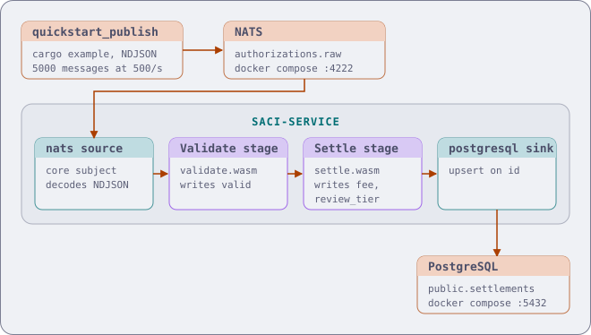

# Quick Start: NATS to PostgreSQL through two processors

One `saci-service` instance runs `quickstart.kdl`: a single pipeline that chains
two WASI 0.3 Rust processor components against one Arrow schema. A NATS core
subject feeds NDJSON authorisations in. The validation stage (`validate.wasm`)
marks each row valid or invalid, the settlement stage (`settle.wasm`) writes
the fee and the review tier, and the rows land in a PostgreSQL `settlements`
table.



Delivery is at-most-once: the stream runner acknowledges nothing and keeps no
checkpoints, so a service killed mid-batch loses that batch.

The `Order` schema reserves five derived fields (`usd_amount`,
`usd_amount_display`, `risk_score`, `flagged`, `settlement`) unused by these two
stages, so the publisher writes them zeroed or empty and they pass through to
PostgreSQL unchanged.

## Prerequisites

- Rust with the `wasm32-wasip3` target: `rustup target add wasm32-wasip3`
- A Docker daemon, for the NATS and PostgreSQL containers

Run every command from the repository root. They are the same on Linux, macOS
and Windows (PowerShell).

## Run it

1. Build both processor components into `examples/quickstart/build/`:

   ```text
   cargo xtask quickstart
   ```

   The output contains `[quickstart] PASS: components in` followed by the
   `examples/quickstart/build` path. `ls examples/quickstart/build` lists
   `validate.wasm` and `settle.wasm`.

2. Start NATS and PostgreSQL. `schema.sql` creates the destination table on
   first initialisation, because the `postgresql` sink never issues `CREATE TABLE`:

   ```text
   docker compose -f examples/quickstart/docker-compose.yml up -d
   ```

   `docker compose -f examples/quickstart/docker-compose.yml ps` shows both
   containers `healthy` after a few seconds.

3. Start the service. NATS and PostgreSQL are opt-in connectors, so the
   command names them. Leave it running:

   ```text
   cargo run -p saci --features server,connector-nats,connector-postgresql -- serve -c examples/quickstart/quickstart.kdl
   ```

4. In a second terminal, publish 5000 authorisations at 500 per second.
   `--count 0` runs until Ctrl-C, for watching the dashboard against a live
   stream:

   ```text
   cargo run -p saci --example quickstart_publish --features connector-nats -- --count 5000 --rate 500
   ```

   It prints `publishing 5000 authorisations to authorizations.raw ...` and,
   after about ten seconds, `published 5000 authorisations in ...`.

5. Open the dashboard at <http://127.0.0.1:8080/ui> while it runs. The
   Pipelines tab draws the workflow as source, `validate`, `settle`, sink.

6. Read the result. `review_tier` is the settlement decision the settle stage
   writes: `0` settled, `1` held for review (amount above `hold_above`), `2`
   rejected (the validate stage found the amount below `min_amount`). The
   publisher draws amounts that reach both thresholds, so all three tiers
   appear:

   ```text
   docker compose -f examples/quickstart/docker-compose.yml exec -T postgres psql -U postgres -d saci -c 'select review_tier, count(*), round(sum(fee)::numeric, 2) as fees from settlements group by review_tier order by review_tier;'
   ```

   Rejected rows carry a fee of `0`. Stop the service with Ctrl-C.

## Tear down

```text
docker compose -f examples/quickstart/docker-compose.yml down -v
```

## Files

| File | What it is |
|------|------------|
| `quickstart.kdl` | the one service: NATS in, `validate`, `settle`, PostgreSQL out |
| `quickstart_publish.rs` | the `saci` example that feeds the NATS subject |
| `docker-compose.yml` | NATS 2.11 and PostgreSQL 18, host ports 4222 and 5432 |
| `schema.sql` | the `settlements` table, mounted into the Postgres container |
| `stages/validate/` | the validation Rust WASI 0.3 processor |
| `stages/settle/` | the settlement Rust WASI 0.3 processor |
| `build/` | the two components `cargo xtask quickstart` produces (gitignored) |

A built component loads into any pipeline whose declared components match what
its `describe()` reports.
