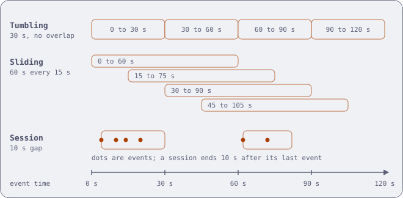

# Windowing: one runnable example per window kind

A `window` block turns an unbounded stream into per-key aggregates over bounded slices of event time. The host validates the geometry, tracks the node's watermark and injects the declaration into the processor's config. The processor keeps its open windows in checkpoint state and emits the closed ones. The window kinds and every key in the block are on the [windowing page](../../docs/content/service/processors/windowing/_index.md); this file is the commands.



Each demo is a long-running `saci-service` stream. Two NATS subjects feed one or more windowed processors, and a PostgreSQL sink upserts every closed window.

| Directory | Config | Window | Processors |
|-----------|--------|--------|------------|
| `tumbling/` | `tumbling/tumbling.kdl` | tumbling, 30 000 ms | a WASM component and a native plugin, identical logic |
| `sliding/` | `sliding/sliding.kdl` | sliding, 60 000 ms every 15 000 ms | one WASM component |
| `session/` | `session/session.kdl` | session, 10 000 ms gap | one WASM component |

Every mode keys on `symbol` with 5 000 ms of allowed lateness. All three read the same two subjects, so run one mode at a time. Their dashboards sit on different ports (8080, 8081, 8082).

## Prerequisites

- A clone of the repository. Every command runs from its root.
- Rust with the `wasm32-wasip3` target: `rustup target add wasm32-wasip3`
- A Docker daemon, for NATS and PostgreSQL.

## 1. Start the containers

Runs the same on Linux, macOS and Windows (PowerShell):

```text
docker compose -f examples/windowing/docker-compose.yml up -d
```

This starts `nats:2.11-alpine` and `postgres:18-alpine`. PostgreSQL runs `schema.sql` only when its data directory is empty, and the sinks never create tables. If a sink fails with `table ... does not exist`, the volume predates the tables. Recreate it:

```text
docker compose -f examples/windowing/docker-compose.yml down -v
docker compose -f examples/windowing/docker-compose.yml up -d
```

Or apply the SQL to the running database.

Linux/macOS:

```bash
docker compose -f examples/windowing/docker-compose.yml exec -T postgres psql -U postgres -d saci < examples/windowing/schema.sql
```

Windows (PowerShell):

```powershell
Get-Content examples/windowing/schema.sql | docker compose -f examples/windowing/docker-compose.yml exec -T postgres psql -U postgres -d saci
```

## 2. Run a mode

Pick one section below. Each builds the processors, starts the service, publishes sales from a second terminal and reads the result.

The publisher sends one NDJSON object per message, alternating between `windowing.sales.a` and `windowing.sales.b`. Each carries `timestamp_ms`, `symbol` (`AAPL`, `GOOG` or `MSFT`) and `amount`. The simulated clock advances `--ts-step-ms` per message, so at the commands' 20 messages per second a minute of event time passes every 15 seconds of wall time.

### Tumbling

Both subjects feed two processors with the same logic, one WASM and one native plugin, so their two tables should match row for row.

Build. Runs the same on all three platforms:

```text
cargo build --release -p windowing-tumbling-wasm --target wasm32-wasip3
cargo build --release -p windowing-tumbling-plugin
```

The config's default plugin path is the Linux name, `target/release/libwindowing_tumbling_plugin.so`. On macOS and Windows set `SACI_PLUGIN_LIB` to your platform's file: `target/release/libwindowing_tumbling_plugin.dylib` or `target/release/windowing_tumbling_plugin.dll`.

Serve. Linux:

```bash
cargo run -p saci --features server,plugin-host,connector-nats,connector-postgresql -- serve --config examples/windowing/tumbling/tumbling.kdl
```

macOS:

```bash
SACI_PLUGIN_LIB=target/release/libwindowing_tumbling_plugin.dylib \
cargo run -p saci --features server,plugin-host,connector-nats,connector-postgresql -- serve --config examples/windowing/tumbling/tumbling.kdl
```

Windows (PowerShell):

```powershell
$env:SACI_PLUGIN_LIB = "target/release/windowing_tumbling_plugin.dll"
cargo run -p saci --features server,plugin-host,connector-nats,connector-postgresql -- serve --config examples/windowing/tumbling/tumbling.kdl
```

Publish from a second terminal. Runs the same on all three platforms:

```text
cargo run -p saci --features connector-nats --example windowed_publish -- --rate 20 --ts-step-ms 2000
```

After about 15 seconds, read both tables:

```text
docker compose -f examples/windowing/docker-compose.yml exec -T postgres psql -U postgres -d saci -c 'SELECT * FROM public.wasm_window_totals ORDER BY window_id, symbol;'
docker compose -f examples/windowing/docker-compose.yml exec -T postgres psql -U postgres -d saci -c 'SELECT * FROM public.plugin_window_totals ORDER BY window_id, symbol;'
```

Both tables carry `window_id`, `symbol`, `count` and `sum`. A window starts at `window_id * 30000` ms, and the plugin table repeats the WASM table's rows. The sinks upsert on `(window_id, symbol)`, so a late re-fire within the lateness budget updates a row.

### Sliding

Both subjects feed one processor, `window_sliding`. Each row lands in four overlapping windows, so one row's `sum` is a 60 second moving total that advances every 15 seconds.

Build, serve and publish. The commands run the same on all three platforms; publish from a second terminal:

```text
cargo build --release -p windowing-sliding-wasm --target wasm32-wasip3
cargo run -p saci --features server,connector-nats,connector-postgresql -- serve --config examples/windowing/sliding/sliding.kdl
cargo run -p saci --features connector-nats --example windowed_publish -- --rate 20 --ts-step-ms 2000
```

Read the table:

```text
docker compose -f examples/windowing/docker-compose.yml exec -T postgres psql -U postgres -d saci -c 'SELECT * FROM public.sliding_window_totals ORDER BY window_start_ms, symbol;'
```

`public.sliding_window_totals` carries `window_start_ms`, `window_end_ms` (always the start plus 60 000), `symbol`, `count` and `sum`. Consecutive starts are 15 000 ms apart. The sink upserts on `(window_start_ms, symbol)`.

### Session

Both subjects feed one processor, `window_session`. A session lasts while one symbol's events arrive no more than 10 000 ms apart, so the data sets its length.

With a steady clock a symbol goes quiet only by chance, and nothing bounds a session. The publisher's `--gap-every 20 --gap-ms 30000` adds a 30 second jump after every 20 messages, which ends every symbol's session at the same moment.

Build, serve and publish. The commands run the same on all three platforms; publish from a second terminal:

```text
cargo build --release -p windowing-session-wasm --target wasm32-wasip3
cargo run -p saci --features server,connector-nats,connector-postgresql -- serve --config examples/windowing/session/session.kdl
cargo run -p saci --features connector-nats --example windowed_publish -- --rate 20 --ts-step-ms 2000 --gap-every 20 --gap-ms 30000
```

Read the table:

```text
docker compose -f examples/windowing/docker-compose.yml exec -T postgres psql -U postgres -d saci -c 'SELECT * FROM public.session_window_totals ORDER BY session_start_ms, symbol;'
```

`public.session_window_totals` carries `session_start_ms`, `session_end_ms` (the symbol's last event in the burst plus 10 000), `symbol`, `count` and `sum`. Expect one row per burst per symbol. A span, `session_end_ms - session_start_ms`, above 48 000 ms means the gap flags did not reach the clock: a burst spans at most 38 000 ms, plus the 10 000 ms gap. The sink upserts on `(session_start_ms, symbol)`.

## 3. Open the dashboard

Open http://127.0.0.1:8080/ui for tumbling, `:8081` for sliding or `:8082` for session. Each processor box shows a window chip. Its detail sheet lists the geometry, the time and key fields, the lateness budget and the live watermark in UTC. The processors report `window.open`, `window.closed` and `window.late_rows`, so every sheet reads the same in every mode.

## Restart the service with the publisher

The simulated clock starts at the same base on every run. A publisher restarted against a running service rewinds event time, but the watermark does not rewind. Every arrival is then past the 5 second lateness budget, the processor drops all of it, and the tables stop filling. The service logs one warning on the `saci::windowing` target, counts each drop in `saci_window_late_arrivals_total`, and shows a `dropped arrivals` row on the processor's sheet. Stop and start both together.

## Publisher flags

| Flag | Default | Meaning |
|------|---------|---------|
| `--count N` | `0` | messages to send; 0 runs until Ctrl-C |
| `--rate N` | `20` | messages per second |
| `--ts-step-ms N` | `2000` | simulated milliseconds per message |
| `--gap-every N` | `0` | messages per burst; 0 means no gaps |
| `--gap-ms N` | `0` | simulated milliseconds each gap adds; required with `--gap-every` |
| `--url URL` | `nats://localhost:4222` | NATS server |
| `--subject-a NAME`<br>`--subject-b NAME` | `windowing.sales.a`<br>`windowing.sales.b` | the two subjects |
| `--seed N` | a fixed constant | a re-run reproduces the same sequence |

## Validate and clean up

To check a config without running it, use `validate` in place of `serve` and add `--strict`. Tumbling needs `plugin-host` and `SACI_PLUGIN_LIB` as above. Sliding and session need neither.

Stop the containers and delete their data:

```text
docker compose -f examples/windowing/docker-compose.yml down -v
```

`cargo xtask demo windowing_tumbling` (or `windowing_sliding`, `windowing_session`) builds the processors and the service, writes a config copy under `target/xtask/` with the plugin path filled in, and prints the `serve` and publisher commands to run.

## Files

| Path | What it is |
|------|------------|
| `tumbling/tumbling.kdl` | the workflow with both tumbling processors |
| `tumbling/wasm/`, `tumbling/plugin/` | `windowing-tumbling-wasm` (cdylib, `wasm32-wasip3`) and `windowing-tumbling-plugin` (cdylib) |
| `sliding/sliding.kdl`, `sliding/wasm/` | the sliding workflow and `windowing-sliding-wasm` |
| `session/session.kdl`, `session/wasm/` | the session workflow and `windowing-session-wasm` |
| `windowed_publish.rs` | the `windowed_publish` example that feeds both subjects |
| `schema.sql` | the four tables, mounted into the PostgreSQL container |
| `docker-compose.yml` | NATS 2.11 and PostgreSQL 18 |
