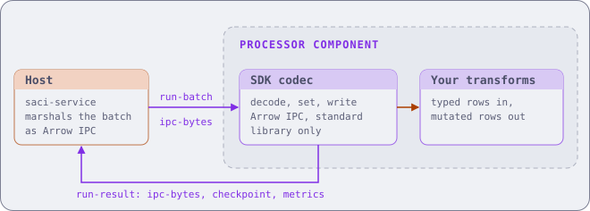

# saci-sdk

One package per language for writing SACI processors. Each package carries an Arrow IPC codec
that reads and edits the host to processor wire format with the language's standard library
only, so a processor decodes a batch without an Arrow dependency that has to survive its
componentizer. The codec stays internal and keeps its original module name.



The format is specified in
[the wire format reference](https://nassor.github.io/saci/library/reference/wire-format/).
A sixth language can reimplement it from there.

## Coordinates

All five packages ship at the version in `VERSION`: one wire format, one version. The Kotlin
KSP symbol processor (`saci-sdk-kt-ksp`) and the C# source generator (`Saci.Sdk.Generators`)
run at build time only. The generator is packed inside `Saci.Sdk`, and the KSP processor
publishes to the same Maven repository as `saci-sdk-kt`.

| Language | Directory | Coordinate | Codec import |
|---|---|---|---|
| Go | `saci-sdk-go` | `github.com/nassor/saci/packages/saci-sdk-go` | subpackage `arrowipc` |
| Python | `saci-sdk-py` | `saci-sdk` | `saci_sdk.arrow_ipc` |
| TypeScript | `saci-sdk-ts` | `@nassor/saci-sdk` | `./arrow_ipc.ts` (internal) |
| Kotlin | `saci-sdk-kt` (+ KSP `saci-sdk-kt-ksp`) | `io.github.nassor:saci-sdk-kt` | `io.github.nassor.saci.arrowipc` |
| C# | `saci-sdk-cs` (+ generator `Saci.Sdk.Generators`) | `Saci.Sdk` | `Saci.ArrowIpc` |

## Install

Python, TypeScript and C# are GitHub Release assets of the `sdk-v0.1.0` tag. Go resolves
through the module proxy from the `packages/saci-sdk-go/v0.1.0` tag. Neither tag exists yet, so
these commands fail until the release below is cut. `cargo xtask pack-sdk` builds every
artifact into `target/arrow-ipc-dist/` under the names the release will serve.

Runs the same on Linux, macOS and Windows (PowerShell):

```bash
# Go
go get github.com/nassor/saci/packages/saci-sdk-go@v0.1.0

# Python
pip install saci_sdk-0.1.0-py3-none-any.whl

# TypeScript
npm install ./nassor-saci-sdk-0.1.0.tgz

# C#
dotnet nuget add source <download-dir> -n saci-local
dotnet add package Saci.Sdk --version 0.1.0
```

Kotlin resolves from a static Maven repository the docs site serves, with the KSP processor
beside the runtime:

```kotlin
repositories {
    maven("https://nassor.github.io/saci/maven")
    mavenCentral()
}

dependencies {
    implementation("io.github.nassor:saci-sdk-kt:0.1.0")
    add("kspWasmWasi", "io.github.nassor:saci-sdk-kt-ksp:0.1.0")
}
```

## Tests

Every suite reads `examples/polyglot/generated/`, so run the emitter first from the repository
root. It runs the same on Linux, macOS and Windows (PowerShell):

```bash
cargo run -p saci --features wasm-host --example polyglot_schema_emit -- emit
```

Then run the five suites. Linux/macOS:

```bash
cd packages/saci-sdk-go && go test ./...
cd packages/saci-sdk-py && PYTHONPATH=src python -m unittest discover -s tests
cd packages/saci-sdk-ts && npm ci && npm run typecheck && npm run build && npm test
cd packages/saci-sdk-kt && gradle jvmTest
cd packages/saci-sdk-cs && dotnet test tests
```

Windows (PowerShell):

```powershell
cd packages\saci-sdk-go; go test ./...
$env:PYTHONPATH = "src"; cd packages\saci-sdk-py; python -m unittest discover -s tests
cd packages\saci-sdk-ts; npm ci; npm run typecheck; npm run build; npm test
cd packages\saci-sdk-kt; gradle jvmTest
cd packages\saci-sdk-cs; dotnet test tests
```

Each suite covers its SDK and codec, including the shared corpus in
[`arrow-ipc-conformance/`](arrow-ipc-conformance/).

## Release

1. Bump `VERSION` and every file that declares it:
   - `saci-sdk-py/pyproject.toml`, `saci-sdk-ts/package.json`, `saci-sdk-kt/build.gradle.kts`,
     `saci-sdk-kt-ksp/build.gradle.kts` and `saci-sdk-cs/Saci.Sdk.csproj`;
   - the `implementation("io.github.nassor:saci-sdk-kt:...")` line in
     `saci-sdk-kt-ksp/build.gradle.kts`;
   - the `implementation("io.github.nassor:saci-sdk-kt:...")` and
     `add("kspWasmWasi", "io.github.nassor:saci-sdk-kt-ksp:...")` lines in
     `examples/polyglot/stages/kotlin-fee/build.gradle.kts`.

   Go carries no manifest version: its version is the git tag.
2. Run `cargo xtask pack-sdk`. It checks that every declaration matches `VERSION`, builds each
   artifact into `target/arrow-ipc-dist/`, and writes the Kotlin publications into
   `docs/static/maven/`.
3. Commit, including `docs/static/maven/**`, and push to `main`. `docs.yml` redeploys the Pages
   site, and Zola copies `docs/static/` verbatim, which makes the Maven repository live.
4. Tag `sdk-v<version>` and push the tag. `release-sdk.yml` packs again, creates the release with
   the assets, and pushes the `packages/saci-sdk-go/v<version>` tag the Go module proxy serves.

## License

This subtree is Apache-2.0, per `LICENSE-APACHE`. The rest of the repository, the engine
crates included, is AGPL-3.0-only.
