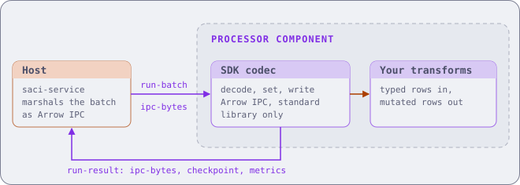

# @nassor/saci-sdk

Processor authoring for [SACI](https://github.com/nassor/saci) WebAssembly pipelines.
Declare a component, write transforms against typed rows, export a processor:
the SDK owns the descriptor, the schema fingerprint, the Arrow decode/encode and
the WIT error shape.

```ts
import { component, transform, transformBatch, processor, type InferRow } from '@nassor/saci-sdk';

const Order = component('Order', {
  id: 'i64',
  region: 'utf8',
  currency: 'utf8',
  amount: 'f64',
  valid: 'bool',
  usdAmount: 'f64',
  usdAmountDisplay: 'utf8',
  riskScore: 'f64',
  flagged: 'bool',
  fee: 'f64',
  reviewTier: 'i64',
  settlement: 'utf8',
} as const);

type Order = InferRow<typeof Order>;

const score = transform(Order, (row: Order, config) => {
  const threshold = config.float('risk_threshold', 50000);
  row.riskScore = row.usdAmount / threshold;
  row.flagged = row.riskScore >= 1.0;
});

const report = transformBatch(Order, (rows, config) => {
  config.metric('score.flagged_rows', rows.filter((row) => row.flagged).length);
});

export const pipeline = processor('my-stage', '0.1.0', score, report);
```

No decorators: TC39 decorators do not survive the transform `jco componentize` runs, and the
legacy ones carry only `design:type` metadata, which cannot describe a field list. A declaration
object is what both a bundler and a type checker understand. `InferRow` turns it into the row
type, so `row.usdAmount` autocompletes and a typo is a compile error, with no code generator and
no build step. `InferRow` is a type, so nothing of it reaches the component.

## Install

Install the tarball from the `sdk-v0.1.0` GitHub release:

```bash
npm install ./nassor-saci-sdk-0.1.0.tgz
```

The release is not cut yet and the package is not on the npm registry. `cargo xtask pack-sdk`
builds the tarball into `target/arrow-ipc-dist/`. Runs the same on Linux, macOS and Windows
(PowerShell).

It requires Node 24.12 or later, the floor `jco` sets, and has no runtime dependencies: the
Arrow IPC codec is internal source (`src/arrow_ipc.ts`), compiled into the package and
re-exported from its entry.

## API

| export | what it does |
|--------|--------------|
| `component(name, fields)` | Declares a component. Property order is wire order; camelCase properties become snake_case columns (`usdAmountDisplay` addresses `usd_amount_display`). Field types are `'i64' \| 'f64' \| 'bool' \| 'utf8'`. |
| `InferRow<typeof Spec>` | The row type the declaration implies: `'i64'` and `'f64'` are `number`, `'bool'` is `boolean`, `'utf8'` is `string`. |
| `transform(spec, (row, config) => void)` | A per-row system. Writes to `row` are what the batch returns. |
| `transformBatch(spec, (rows, config) => void)` | A per-batch system, for a total, a metric or one log line. |
| `processor(name, version, ...transforms)` | The `{ describe, runBatch }` object a stage exports. Transforms run in registration order. |
| `SaciSdkError` | Every refusal the SDK raises. |

`config` is the host, narrowed to what a transform may reach for:

- `config.float(key, fallback)` reads a `get-config` value, requires a positive
  finite number, and memoises per batch, so asking for it inside a per-row
  transform costs one host call for the whole batch.
- `config.metric(name, value)` and `config.log(level, target, message)` bridge to
  the host's metrics and `tracing`.

## What the processor does per batch



The processor decodes the input stream and reads the declared components' rows into plain
objects. It runs every transform in order, re-encodes the rows, and returns the stream. The
`__alive` bitmap and every component the processor does not declare pass through byte-identically.
`describe()` reports the declared components' Arrow schemas and the FNV-1a schema fingerprint the
host validates against its own registry.

Every failure leaves `run-batch` as `run-error::permanent`, thrown as the plain object
`{ tag, val }`: componentize-js re-throws anything `instanceof Error`, which traps the component.

The processor is stateless. It returns no checkpoint, so `describe()` reports `stateful: false`
and the host persists nothing for it.

## Tests

The suites read the corpus in `../arrow-ipc-conformance/` and the output of the repository's
schema emitter, so run the emitter first from the repository root:

```bash
cargo run -p saci --features wasm-host --example polyglot_schema_emit -- emit
```

Then, from `packages/saci-sdk-ts`. Linux/macOS:

```bash
npm ci && npm run typecheck && npm run build && npm test
```

Windows (PowerShell):

```powershell
npm ci; npm run typecheck; npm run build; npm test
```

## License

Apache-2.0.
